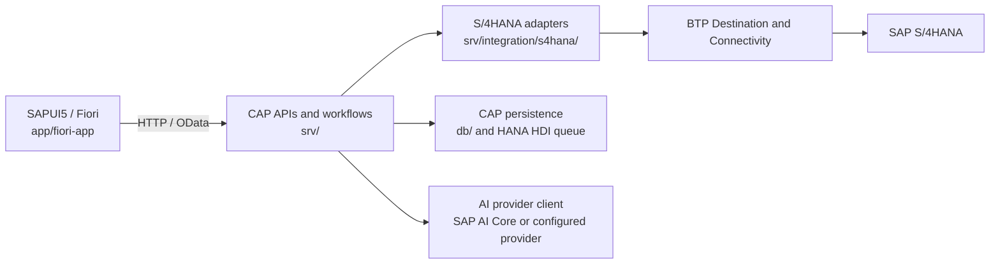

# SAP S/4HANA Full-Stack Platform

A SAPUI5/Fiori application and SAP CAP service layer for business workflows that integrate
with SAP S/4HANA through adapters in `srv/integration/s4hana/`. The repository includes
MM, WM, LE, SD, FI, and AI service areas, automated tests, and SAP BTP deployment files.

## Project at a glance

| Area | Location | Purpose |
| --- | --- | --- |
| Fiori application | `app/fiori-app/` | SAPUI5 views, controllers, routing, and user experience |
| CAP services | `srv/` | HTTP/OData APIs, authorization, validation, and orchestration |
| S/4HANA integration | `srv/integration/s4hana/` | Technical clients, adapters, and SAP payload mappings |
| Persistence | `db/` | CAP data model; the MTA provisions HANA for the goods-issue dispatch queue |
| Configuration | `config/`, `mta/`, `mta.yaml`, `xs-security.json` | Destination/Connectivity templates, deployment topology, and XSUAA roles |
| Tests | `test/` | Unit, integration, and end-to-end tests with controlled fixtures |

## Business areas

- **Materials Management:** Purchase order worklist, value helps, draft creation, and activation.
- **Warehouse Management:** Goods issue and receipt, reservations, TR/TO flows, movement 261,
  handling units, packing instructions, and reservation tracking.
- **Logistics Execution:** Outbound delivery workflows.
- **Sales and Distribution:** Sales inquiries, sales orders, customer invoices, and returns.
- **Financial Accounting:** Journal entry verification.
- **AI assistance:** CAP chat actions and streaming backed by the configured AI provider.

These describe application areas in the repository. They do not establish that a particular
SAP service is active or supports a write operation. Before implementing SAP transactions,
follow the [SAP API discovery rules](AGENTS.md#sap-api-discovery--non-negotiable-protocol).

## Architecture



Keep presentation, business orchestration, persistence, and S/4HANA technical calls within
their repository boundaries. The detailed rules are in [AGENTS.md](AGENTS.md).

## Requirements

- Node.js 22 or later, as declared in `package.json` and used by CI.
- npm.
- For MTA packaging or deployment: the Cloud MTA Build Tool (`mbt`) and the relevant Cloud
  Foundry tooling and access.
- For SAP-backed local workflows: valid local configuration or an appropriate BTP-bound
  Destination and Connectivity setup.

## Local setup

Install dependencies from both lockfiles:

```sh
npm ci
npm --prefix app/fiori-app ci
```

For local SAP connections, review `.env.example` and create `.env.local` with only the values
needed for your environment. The local server loads `.env.local` when present. Keep credentials
out of source control; deployed environments should use BTP service bindings and destinations.

Start the CAP application and UI5 development integration:

```sh
npm run watch
```

The local Fiori app is served at `http://localhost:4004/fiori-app/webapp/index.html`. The health
endpoint is `http://localhost:4004/health`. SAP-backed operations require working connection
configuration and appropriate authorization.

To run the UI5 development server separately:

```sh
npm --prefix app/fiori-app start
```

## Tests and checks

Use the scripts defined in `package.json` and `app/fiori-app/package.json`:

| Command | Check |
| --- | --- |
| `npm test` | Full Jest suite |
| `npm run test:unit` | Unit tests |
| `npm run test:integration` | Integration tests |
| `npm run test:e2e` | Playwright browser E2E suites (needs a running server; coverage in `docs/e2e-coverage-matrix.md`) |
| `npm run lint` | Root ESLint |
| `npm --prefix app/fiori-app run lint` | UI5 lint |
| `npm --prefix app/fiori-app run build` | UI5 production build |
| `npm run validate:mta` | Validate the base MTA descriptor |

The configured [GitHub Actions workflow](.github/workflows/ci.yml) runs root and UI5 lint,
the Jest suite, the UI5 build, and base MTA validation. It runs on pushes to `main` and
`feature/**`, pull requests targeting `main`, and manual dispatch. Check the latest workflow
run for current validation results.

## SAP integration and security

- S/4HANA communication belongs in `srv/integration/s4hana/`; UI code calls CAP APIs only.
- Do not infer create capability from a service name, activation, or successful GET. Verify
  the actual system's metadata and operation, and prove persistence as required by
  [AGENTS.md](AGENTS.md#sap-api-discovery--non-negotiable-protocol).
- Never commit credentials, service keys, tokens, or environment-specific connection values.
- Deployed configuration uses BTP Destination, Connectivity, and XSUAA bindings. Environment
  extensions are under `mta/extensions/dev/`, `test/`, and `prod/`.
- `creatable-services.xlsx` is generated. Follow the regeneration steps in `AGENTS.md`; do not
  edit the workbook manually.

## Deployment build

```sh
npm run validate:mta
npm run build:mta
```

The build uses `mta.yaml` and packages the CAP service, Fiori application, and HDI artifacts.
Review the appropriate environment extension before preparing a deployment. MTA validation
does not verify live SAP connectivity, destination credentials, or backend transaction support.

## Repository guide

| Path | Contents |
| --- | --- |
| `srv/mm/`, `srv/wm/`, `srv/le/`, `srv/sd/`, `srv/fi/`, `srv/ai/` | CAP domain services and handlers |
| `srv/integration/s4hana/` | S/4HANA clients and adapters |
| `db/` | CDS persistence model and seed data |
| `app/fiori-app/webapp/modules/` | Fiori business-area modules |
| `test/unit/`, `test/integration/`, `test/e2e/` | Automated test suites |
| `docs/` | Architecture, SAP discovery evidence, decisions, and runbooks |
| `skills/` | Project agent skills; see [the skill catalog](skills/README.md) |
| `WORKSTATUS.md` | Work history, validation results, blockers, and next steps |
