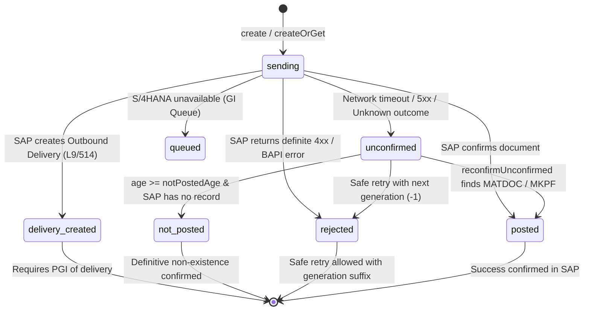

# Common Posting-Attempt Lifecycle & Shared Contract

**Document Reference**: `docs/architecture/posting-attempt-lifecycle.md`  
**Related Decision**: `docs/decisions/ADR-0001-s4-centric-integration-facade.md`  
**Finding Reference**: DEBT-01 (Posting-attempt store multiple responsibilities)  
**Status**: Accepted Architectural Baseline  
**Date**: 2026-11-19  

---

## 1. Executive Summary

In the SAP S/4HANA Full-Stack Cloud Application Programming (CAP) platform, warehouse and inventory mutations (e.g. Movement 101 Goods Receipts) interact directly with SAP S/4HANA via transactional BAPIs and OData services. Because network partitions, process crashes, or backend timeouts can sever communication after SAP has processed a transaction but before the client receives the response, the system implements an **At-Most-Once / Idempotent Posting Pattern**.

To enforce this, every transaction writes a durable **Posting Attempt** to a shared database (SAP HANA HDI container) *before* invoking SAP. If a failure or uncertain outcome occurs, background recheck workers reconcile the attempt against S/4HANA backend tables (`MATDOC`, `MKPF`) without blind retries or duplicate postings.

Historically, this functionality grew inside a goods-issue attempt store. Following the full decommissioning of Goods Issue across the repository, the store and entity have been refactored into a dedicated Goods Receipt store: `srv/wm/goods-receipt/GoodsReceiptAttemptStore.js` and `db/wm/goods-receipt-attempt.cds`:
1. Attempt creation
2. Idempotency & reference collision prevention
3. Reclaim generations & audit trail tracking
4. Goods receipt reconciliation
5. Unconfirmed document read-back
6. Background retry scheduling & distributed worker leasing

This document formally defines the **Common Posting-Attempt Lifecycle State Machine**, establishes the **Shared Storage Contract**, and details the **Future Modularization Blueprint** to decouple generic attempt persistence from movement-specific reconciliation without disrupting production stability or breaking backward compatibility.

---

## 2. Architectural Motivation: Why Pre-Commit Attempt Tracking is Required

Under [ADR-0001](docs/decisions/ADR-0001-s4-centric-integration-facade.md), S/4HANA is the authoritative system of record for all business objects. Local database storage is strictly prohibited from holding persistent business data. However, transactional boundaries across distributed systems introduce the **Uncertain Outcome Window**:

```text
Client (CAP)                         S/4HANA Backend
    │                                       │
    │  1. BAPI / OData POST                 │
    ├──────────────────────────────────────>│
    │                                       │ (SAP commits document)
    │  2. Network timeout / process crash   │
    │  x - - - - - - - - - - - - - - - - -  │
    ▼                                       ▼
Outcome Unknown: Did SAP commit the document or rollback?
```

If the CAP server simply retries the request upon timeout, S/4HANA risks creating a **duplicate posting** (double deduction of stock or duplicate receipt). If the CAP server reports failure to the user, the user may retry manually, compounding the error.

### Architectural Rules
1. **Durable Persistence Before SAP Call**: The attempt record must be committed to durable persistence (SAP HANA) *before* the S/4HANA network call is dispatched.
2. **Fail-Closed on Database Loss**: If the durable database is unavailable, the application must immediately throw HTTP 503 (`DB_UNAVAILABLE`) and block the SAP write. In-memory fallback is completely removed; the store strictly requires durable database persistence (`db/wm/goods-receipt-attempt.cds`) in all environments.
3. **Reconciliation Over Blind Retry**: An attempt with an uncertain outcome (`sending`, `unconfirmed`) must be reconciled by querying backend SAP tables before any retry is permitted.
4. **Multi-Instance Distributed Leases**: Cloud Foundry environments run multiple instances (HA topology). Background rechecks and attempt claims must use distributed worker leases and atomic Compare-And-Swap (CAS) operations to prevent concurrent processing.

---

## 3. Posting Attempt Lifecycle State Machine



### State Definitions

| Status | Category | Description | Permitted Next States |
| :--- | :--- | :--- | :--- |
| `sending` | Open | The attempt is persisted in the database; SAP call is in progress or died mid-flight. | `posted`, `rejected`, `unconfirmed`, `delivery_created`, `queued` |
| `unconfirmed` | Open | S/4HANA call timed out, failed with HTTP 500, or returned without confirming document persistence. Requires backend reconciliation. | `posted`, `not_posted`, `rejected` |
| `queued` | Open | S/4HANA service not activated/authorized; transaction queued locally for deferred dispatch. | `sending`, `rejected` |
| `posted` | Final | S/4HANA successfully processed the transaction; document persistence confirmed with SAP document number and year. | Terminal (`*`) |
| `rejected` | Final | S/4HANA explicitly rejected the request (e.g. validation error, insufficient stock); no material document exists. Re-claim permitted. | Terminal (`*`) |
| `not_posted` | Final | Recheck worker verified that no document matching the reference exists in S/4HANA after the grace period (`notPostedAgeMs`, default 15m). | Terminal (`*`) |
| `delivery_created` | Final | S/4HANA created an outbound delivery instead of a material document (WM-managed storage location, L9/514). Process in SAP GUI via VL02N/VL03N. | Terminal (`*`) |

- **`OPEN_STATUSES`**: `['sending', 'unconfirmed', 'queued']`  
- **`FINAL_STATUSES`**: `['posted', 'rejected', 'not_posted', 'delivery_created']`

### Reclaim Generations & Audit Trail

When an initial attempt (`GR101_1001-0`) is definitively rejected or marked `not_posted`, the user may correct input parameters and retry. To preserve the complete audit trail:
- Prior attempt rows are preserved intact in HANA.
- The new attempt generates the next sequence suffix (`GR101_1001-1`).
- `RequestHash` tracks identity across generations.
- If an attempt is still in an open status (`sending`, `unconfirmed`), blind re-claim is rejected with HTTP 409 Conflict.

---

## 4. The Shared Storage Contract (`IPostingAttemptStore`)

The underlying persistence model is defined in `db/wm/goods-receipt-attempt.cds` as `saps4hana.wm.GoodsReceiptPostingAttempt`. The shared contract comprises three tiers of attributes:

```cds
entity GoodsReceiptPostingAttempt : cuid, managed {
    // Tier 1: Generic Lifecycle & Idempotency Attributes
    ReferenceDocument : String(16) not null;   // Correlated SAP reference / key
    RequestHash       : String(64);            // Payload idempotency hash
    MovementType      : String(3);             // SAP Movement (101, 261, 201)
    Status            : String(20);            // sending | posted | rejected | ...
    ResolvedAt        : Timestamp;             // Timestamp when finalized
    PostingUser       : String(255);           // Authenticated user
    PostingDate       : Date;                  // Posting date
    LastError         : String(500);           // Error message (never lease data)
    LeaseOwner        : String(64);            // Unique token of the recheck run holding the lease
    LeaseExpiresAt    : Timestamp;             // Lease expiry
    BaselineDocs      : String(5000);          // JSON array of 101 documents existing before the post; null = unknown

    // Tier 2: S/4HANA Confirmed Document Attributes
    MaterialDocument  : String(10);            // Confirmed MBLNR
    MaterialDocYear   : String(4);             // Confirmed MJAHR
    DeliveryNumber    : String(10);            // Outbound delivery (L9/514)

    // Tier 3: Contextual Business Attributes
    ReservationNo     : String(10);            // Reservation or Inbound Delivery
    ReservationItem   : String(6);             // Item or Delivery Item (POSNR)
    Material          : String(40);            // Material number
    Plant             : String(4);             // Plant
    StorageLocation   : String(4);             // Storage location
    CostCenter        : String(10);            // Cost center
    IssueQty          : Decimal(13, 3);        // Quantity
    Unit              : String(10);            // Unit of measure
}
```

### Core Generic Interface

Every posting attempt store implementation must satisfy this contract:

```typescript
interface IPostingAttemptStore {
  // Availability & durable database state
  isAvailable(): boolean;

  // Attempt creation & atomic claiming
  create(data: PostingAttemptInput): Promise<PostingAttemptRow>;
  createOrGet(data: PostingAttemptInput, reclaimPolicy?: ReclaimPolicy): Promise<{ created: boolean, row: PostingAttemptRow }>;
  getByReference(referenceDocument: string): Promise<PostingAttemptRow | null>;

  // Lifecycle status transitions
  setStatus(referenceDocument: string, status: string, extraFields?: ExtraStatusFields): Promise<void>;

  // Distributed multi-instance leasing (Compare-And-Swap)
  claimAttemptForRecheck(referenceDocument: string, workerId?: string, leaseMs?: number, now?: number): Promise<string | false>; // lease token
  releaseAttemptLease(referenceDocument: string, leaseToken: string): Promise<void>;
  setBaseline(referenceDocument: string, docKeys: string[] | null): Promise<void>;
}
```

---

## 5. Movement Reconciliation Protocol

Following the complete decommissioning of Goods Issue (Movement 261/201), the posting attempt store is dedicated to protecting Movement 101 Goods Receipt against inbound deliveries.

### Goods Receipt Reconciliation (Movement 101 against Inbound Delivery)
- **SAP Reference Field**: Receipts against inbound deliveries do not populate the material document header reference with our application key. S/4HANA links the receipt via the delivery document number (`ReservationNo`) and item (`ReservationItem` / `POSNR`).
- **Query Mechanism**: `adapter.findReceiptForAttempt(attempt)` searches `MATDOC` for Movement 101 matching the delivery item and compares the result with the attempt's pre-post baseline (`BaselineDocs`, read from `MATDOC` after the claim and before the post).
- **Evidence Rule**: SAP gives the material document no reference to this application (verified on the BAPI interface, 2026-11-21), so a document counts as the attempt's only if it (1) is outside the pre-post baseline, (2) was posted by a logon user of this application (`MATDOC-USNAM`: RFC logon user or HTTP destination user), and (3) carries the attempt's quantity for the delivery item (`ERFMG`, or `MENGE` in base unit, summed over the document's lines). Exactly one such document → `posted`. No document outside the baseline, once the not-posted age has passed → `not_posted`. Everything else — no baseline, a new document by another user or with another quantity, several matches, or an application user that cannot be determined (for example Principal Propagation) — is ambiguous: the attempt stays open and blocked (summary counter `Ambiguous`) until it is resolved manually.
- **Single-Worker Scheduling**: Background recheck timer is enabled exclusively on Cloud Foundry instance 0 (`(env.CF_INSTANCE_INDEX ?? '0') === '0'`).
- **Distributed Worker Lease**: Before querying SAP, the worker executes `claimAttemptForRecheck()`, one atomic `UPDATE` that sets `LeaseOwner` (a unique token per claim) and `LeaseExpiresAt` only when no unexpired lease exists. A result is written only while that token still holds the lease and the attempt is still open. Runs with the same worker id exclude each other; a restarted worker waits for the old lease to expire. `LastError` is never used for lease data.

---

## 6. Separation of Concerns & Completed Decoupling

The posting attempt infrastructure has been fully decoupled:
1. **Goods Issue Decommissioned**: All Movement 261/201 and Outbound Delivery PGI functionality, entities, adapters, and stores have been removed.
2. **Dedicated Goods Receipt Store**: `srv/wm/goods-receipt/GoodsReceiptAttemptStore.js` and `db/wm/goods-receipt-attempt.cds` provide fail-closed persistence, distributed worker leasing, and background reconciliation exclusively for Movement 101 Goods Receipts.
3. **Multi-Instance CAS Protection**: Preserves zero double-posting guarantees in Cloud Foundry multi-instance topologies.

---

## 7. Operational & Verification Rules

1. **Mandatory Logging of Attempt**: Every transactional posting must await `store.createOrGet()` before executing any SAP RFC/OData mutation.
2. **Immediate Outcome Finalization**: Upon definitive SAP response, the caller must immediately invoke `store.setStatus(ref, 'posted' | 'rejected')`.
3. **Timeout Containment**: Upon timeout or HTTP 5xx, the caller must invoke `store.setStatus(ref, 'unconfirmed')` and never retry immediately.
4. **Multi-Worker Safety**: Background recheck jobs must be gated by `isWorker()` and distributed worker leasing.
5. **Validation Verification**: Any changes touching attempt persistence must execute:
   - `test/unit/wm/goodsReceiptTwoInstances.test.js`
   - `test/unit/wm/goodsReceiptAttempt.test.js`
   - `test/unit/wm/goodsReceiptPlantScope.test.js`
   - `test/unit/wm/goodsReceiptService.test.js`
