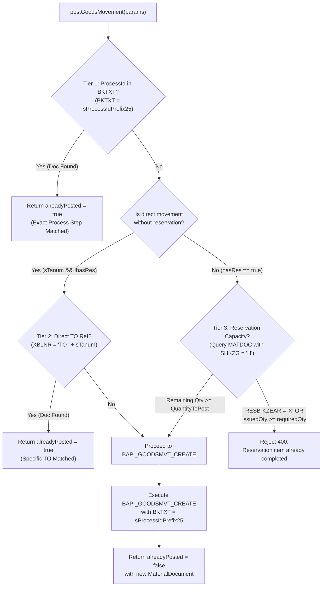

# SAP DDIC/MATDOC Evidence & MIGO Idempotency Architecture Design

## Executive Summary

To achieve robust, deterministic idempotency for SAP S/4HANA MIGO goods movements across Movement Types 201, 241, 301, and 311, live metadata and actual material document records from SAP S/4HANA (Client 220) were inspected. 

This document details:
1. **Controlled SAP DDIC evidence (`DD03L` for `MATDOC` and `RESB`)**.
2. **Analysis of live material documents (`4900050148`, `4900050149`, `4900050142`, `4900050143`, `4900050153`)**.
3. **Root-cause analysis of current retry guard defects** in `ReservationProcessAdapter.postGoodsMovement`.
4. **Target architectural design for MIGO idempotency** without regression to partial postings or two-line transfers.

---

## 1. Controlled SAP DDIC Evidence (`DD03L`)

Live RFC queries against `DD03L` in SAP Client 220 established the following key field positions, data types, and lengths for table `MATDOC`:

| Position | Field Name | Data Type | Length | Description | Role in Idempotency |
|:---:|:---|:---:|:---:|:---|:---|
| **0135** | `MBLNR` | CHAR | 10 | Material Document Number | Primary document identifier |
| **0136** | `MJAHR` | NUMC | 4 | Material Document Year | Document year |
| **0137** | `ZEILE` | NUMC | 4 | Item in Material Document | Line number (e.g. `0001`, `0002`) |
| **0160** | `RSNUM` | NUMC | 10 | Reservation Number | Reservation reference |
| **0161** | `RSPOS` | NUMC | 4 | Reservation Item | Reservation item number |
| **0162** | `TBNUM` | NUMC | 10 | Transfer Requirement Number | TR reference (when IM creates TR) |
| **0163** | `TBPOS` | NUMC | 4 | Transfer Requirement Item | TR item |
| **0165** | `TANUM` | NUMC | 10 | Transfer Order Number | Present in DDIC, but `0000000000` in direct BAPI MIGO |
| **0167** | `XBLNR` | CHAR | 16 | Reference Document Number | Passed from `GOODSMVT_HEADER-REF_DOC_NO` |
| **0173** | `CANCELLED` | CHAR | 1 | Cancellation Indicator | `'X'` if document is cancelled |
| **0175** | `REVERSAL_MOVEMENT` | CHAR | 1 | Reversal Movement Flag | `'X'` if line is a reversal |
| **0185** | `BWART` | CHAR | 3 | Movement Type | `201`, `241`, `301`, `311` |
| **0188** | `LGORT` | CHAR | 4 | Storage Location | Issuing / receiving SLoc |
| **0197** | `SHKZG` | CHAR | 1 | Debit/Credit Indicator | `'H'` = Credit (Issue), `'S'` = Debit (Receipt) |
| **0200** | `SGTXT` | CHAR | 50 | Item Text | Passed from `GOODSMVT_ITEM-ITEM_TEXT` (cleared by standard SAP on reservation refs) |
| **0216** | `KZEAR` | CHAR | 1 | Final Issue for Reservation | `'X'` when reservation item is closed |
| **0330** | `BKTXT` | CHAR | 25 | Header Document Text | Passed from `GOODSMVT_HEADER-HEADER_TXT` (persists on all lines!) |

In table `RESB`:
- `BDMNG` (QUAN 13, 3 decimals): Requirement quantity.
- `ENMNG` (QUAN 13, 3 decimals): Quantity withdrawn / already posted.
- `KZEAR` (CHAR 1): Final issue flag (`'X'` if closed or `NO_MORE_GR` was set).

---

## 2. Analysis of Live SAP Material Documents (Client 220)

Read-only inspection of confirmed documents in Client 220 revealed the exact runtime field behaviors:

### A. Document `4900050153` (Movement 311 with ProcessId)
- `BKTXT`: `"CF3109E96F4B43EC9CA96CE35"` (The stripped 25-char alphanumeric prefix of Process UUID `CF3109E9-6F4B-43EC-9CA9-6CE354E6B018`).
- `SGTXT`: `""` (Blank!).
- `XBLNR`: `"RES 0000525877"`.
- `Line 0001`: `BWART = '311'`, `WERKS = '1120'`, `LGORT = 'CS01'`, `SHKZG = 'H'`, `MENGE = 1.000 KG`.
- `Line 0002`: `BWART = '311'`, `WERKS = '1120'`, `LGORT = 'HS01'`, `SHKZG = 'S'`, `MENGE = 1.000 KG`.

> [!IMPORTANT]
> **Key Finding 1 (`SGTXT` vs `BKTXT`):**
> In standard SAP `BAPI_GOODSMVT_CREATE`, when a reservation reference (`RESERV_NO` / `RES_ITEM`) is provided, standard SAP user exit / logic (SAP Note 1518592) clears `MSEG-SGTXT` / `MATDOC-SGTXT`. However, `GOODSMVT_HEADER-HEADER_TXT` (up to 25 chars) is **consistently preserved in `MATDOC-BKTXT`** across all document lines!

> [!IMPORTANT]
> **Key Finding 2 (`SHKZG` Debit/Credit Indicator):**
> For transfer movements (311 and 301), SAP creates **two lines** in `MATDOC`:
> - Line 1: `SHKZG = 'H'` (Credit = issue from source location)
> - Line 2: `SHKZG = 'S'` (Debit = receipt into destination location)
> Both lines carry identical `RSNUM`, `RSPOS`, and `MENGE`. Any query summing quantities or counting rows without filtering by `SHKZG = 'H'` **doubles the quantity** and triggers false reconciliation errors.

---

## 3. Defects in Current Retry Guard

In `ReservationProcessAdapter.js` lines 694–727:

```javascript
// Current implementation
if (this.rfc) {
  let found = null;
  if (sProcessId) {
    const where = [`SGTXT = '${sProcessId}'`, `AND MATNR = '${s4Mat}'`, ...];
    found = await this.rfc.readTable('MATDOC', ['MBLNR', 'MJAHR'], where, 1);
  }
  if (!found?.[0]?.MBLNR && hasRes) {
    const resWhere = [`RSNUM = '${sResNo}'`, `AND RSPOS = '${sResItem}'`, `AND BWART = '${sMvt}'`, ...];
    found = await this.rfc.readTable('MATDOC', ['MBLNR', 'MJAHR'], resWhere, 1);
  }
  ...
}
```

### Defect 1: `SGTXT` Check Fails Silently for Reservations
Because `SGTXT` is always empty for reservation postings, the first check always yields 0 rows, forcing execution into the `hasRes` fallback.

### Defect 2: `hasRes` Fallback Truncates Multi-TO and Partial Postings
Because the fallback queries `RSNUM = sResNo AND RSPOS = sResItem` with `rowCount = 1`, if **any** material document was previously posted for that reservation item:
- It returns that first document number immediately with `alreadyPosted = true`.
- A second TO or remaining balance can **never be posted**, falsely returning the prior document.

### Defect 3: Two-Line Transfer Double Counting
Documented in `test.failing.each(['311', '301'])`: without `SHKZG = 'H'`, progress reconciliation sees 2 rows for each 1-unit transfer.

---

## 4. Proposed MIGO Idempotency Architecture Design

A 3-tier deterministic idempotency hierarchy ensures safety against network retries, browser re-submits, and multi-TO partial reservations:



### Tier 1: Process UUID Matching via `BKTXT` (Exact Step Identity)
When `processId` is passed (from `ReservationTrack` or `ReservationEntries`):
- Normalize `sProcessIdPrefix25 = processId.replace(/-/g, '').slice(0, 25)`.
- Query `MATDOC`:
  ```javascript
  const where = [
    `BKTXT = '${sProcessIdPrefix25}'`,
    `AND MATNR = '${s4Mat}'`,
    `AND WERKS = '${sPlant}'`,
    "AND CANCELLED = ''",
    "AND REVERSAL_MOVEMENT = ''"
  ];
  found = await this.rfc.readTable('MATDOC', ['MBLNR', 'MJAHR'], where, 1);
  ```
- If found: exactly this client operation has already executed in SAP. Return `{ success: true, alreadyPosted: true, materialDocument: found[0].MBLNR, materialDocYear: found[0].MJAHR }`.

### Tier 2: Direct TO Matching via `XBLNR` (Direct Movements)
When `sTanum` is passed and `hasRes` is false:
- Query `MATDOC` with `XBLNR = 'TO ${sTanum}'` and `CANCELLED = ''`.
- If found: this Transfer Order has already been cleared via MIGO. Return `{ success: true, alreadyPosted: true, ... }`.

### Tier 3: Reservation Capacity & Line-Aware Reconciliation (`SHKZG = 'H'`)
When `hasRes` is true and no prior document matched the exact `processId`:
- Do **not** block merely because a historical document exists for the reservation!
- Read `RESB` for `BDMNG` (Required), `ENMNG` (Withdrawn), and `KZEAR` (Final Issue).
- Query `MATDOC` with `RSNUM = sResNo AND RSPOS = sResItem AND SHKZG = 'H' AND CANCELLED = '' AND REVERSAL_MOVEMENT = ''`.
- Calculate `openQty = Math.max(0, Number(resb.BDMNG) - Number(resb.ENMNG))`.
- If `resb.KZEAR === 'X'` or `openQty <= 0`:
  - Throw 400/422: `Reservation item ${sResNo}/${sResItem} is already fully issued in SAP`.
- If `quantityToPost > openQty`:
  - Throw 400/422: `Requested posting quantity ${quantityToPost} exceeds open reservation quantity ${openQty}`.
- Otherwise: allow the posting to proceed.

---

## 5. Scope & Rollout Strategy

1. **Isolation:** This design addresses the core IM/WM posting boundary in `srv/integration/s4hana/wm/ReservationProcessAdapter.js`.
2. **Backward Compatibility:** All existing tests that pass `processId` will now match accurately on `BKTXT`, fixing the mock and live discrepancy.
3. **Fixes Failing Tests:** Resolves `test.failing.each(['311', '301'])` by strictly filtering on `SHKZG = 'H'`.
4. **Zero Production Risk during Merge:** Kept strictly separate from PR / merge of branch `feature/mvt261_01`.
